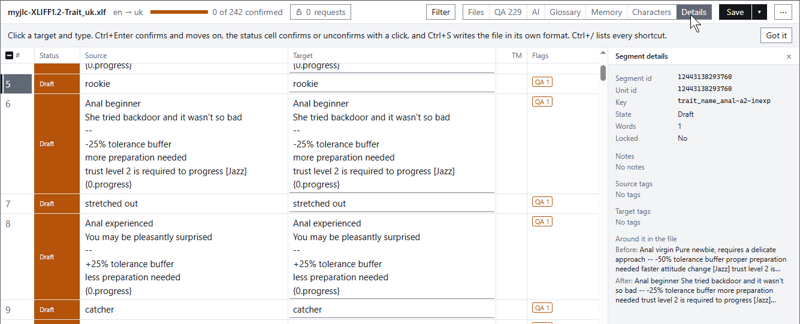
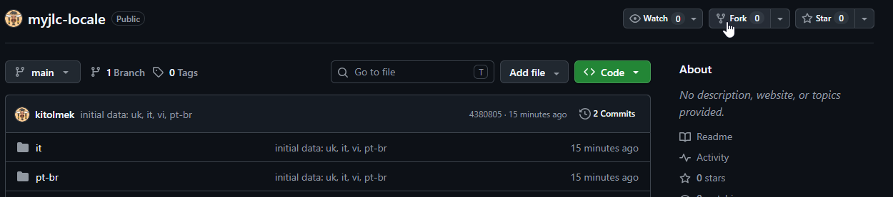

# myjlc-locale

This repository contains the localization text lines for the adult game "My Jazzy Lolly Crush". We don't want to translate the game using AI or automated translators, so we're inviting our players to take a part in adapting the game to their language.


# Data format

The text lines are dumped in XLIFF format v1.2, which is common for game localizations. It is XML-based text format and theoretically you can open it in *any* text editor to make changes. You can even apply small changes using the github built-in text editor with minimal efforts. Though, I suggest using a specialized software to open and edit the files. 

The best editor I tested is [xliff.ai](https://xliff.ai/editor/), which is an online tool, so you don't need to install anything for work. The main selling point (as for me) is that it allows you to see not only the original text but also the line keys, which are all manually defined by me and might help a lot providing more context about where the text line is used. Also it includes some automated quality checks, allows to create a glossary and to connect AI tools, which are not necessary but pleasant bonus features for those who translate things professionally.

## A bit more details for non-IT people

If you'd like to make changes in a text editor, the 'scary codee-like framing' should be left as it is. Each text chunk has the next format:

```
<trans-unit id="12443138293760" xml:space="preserve" resname="trait_name_anal-a2-inexp">
    <source>rookie</source>
    <target>новачок</target>
</trans-unit>
```

Field `resname="XXX"` represents the key I mentioned earlier. It contains the important context usually and helps to understand what label you're looking at.
`<source>YYY</source>` is the original English text for the reference. 
`<target>ZZZ</target>` is the translation. You should change only what's in between the 'target' tags.

When opening a file in the xliff editor, the whole structure will be shown as a table. Most of editors show only 'source' and 'target' parts, but the xliff.ai I recommended has the nice 'details' button showing the key.




# Structure

Each folder contains the lines for a certain language. The files inside represent different scopes:

- myjlc-XLIFF1.2-Help_xx.xlf -- for the 'bubble' tooltips are shown in the game help and welcome screen.
- myjlc-XLIFF1.2-JazzTag_xx.xlf -- for the 'tags' generated in the girl's Jazz profile, representing the traits. That's where original keys come in handy -- those contain the actual trait ids (not UI names, but ids) providing more context for translation.
- myjlc-XLIFF1.2-NamePool_xx.xlf -- potential names for girls. This is the largest subset and it doesn't need an actual translation (I'd like to keep the original cultural context for most of the names), only transliteration into your language. Keys here contain the culture where the name belongs to.
- myjlc-XLIFF1.2-Trait_xx.xlf -- girl traits: names and descriptive tooltips. Keys contain the in-game trait ids, so this can be used to match JazzTags with the familiar trait names.
- myjlc-XLIFF1.2-TrustMod_xx.xlf -- trust modifiers for Jazz mode.
- myjlc-XLIFF1.2-UI_xx.xlf -- for static UI labels. This is the largest actually translatable subset. Keys contain the game area where the label is used: like 'main' for main UI you see all the time while playing, 'settings' for settings window, 'wizard' for sandbox constructor window etc. 'btn' code is used for button tooltips, 'hint' for large labels' tooltips. It's difficult to explain the whole key structure here, but I tried to make it as verbose as possible.
- myjlc-XLIFF1.2-Wardrobe_xx.xlf -- wardrobe item names (this includes toys). 'group_xx" for clothes categories, 'unlock_xx' for the groups unlockable in Jazz mode (these are shown in log and confirmation dialog).


# Workflow

You'll need the github account to participate. Note, if you worry about your privacy and do not want to share your everyday name/nickname, consider creating a separate account for this.

## Fork the repository

It's a bad idea for everyone to write changes into the main codebase, so the most common approach is that you make your own copy, apply changes to it and, when you're happy with the result, suggest your changes to the author.



You can name your copy as you wish. Check 'copy main branch only' if it's unchecked.

## Apply changes


## Make a pull request

